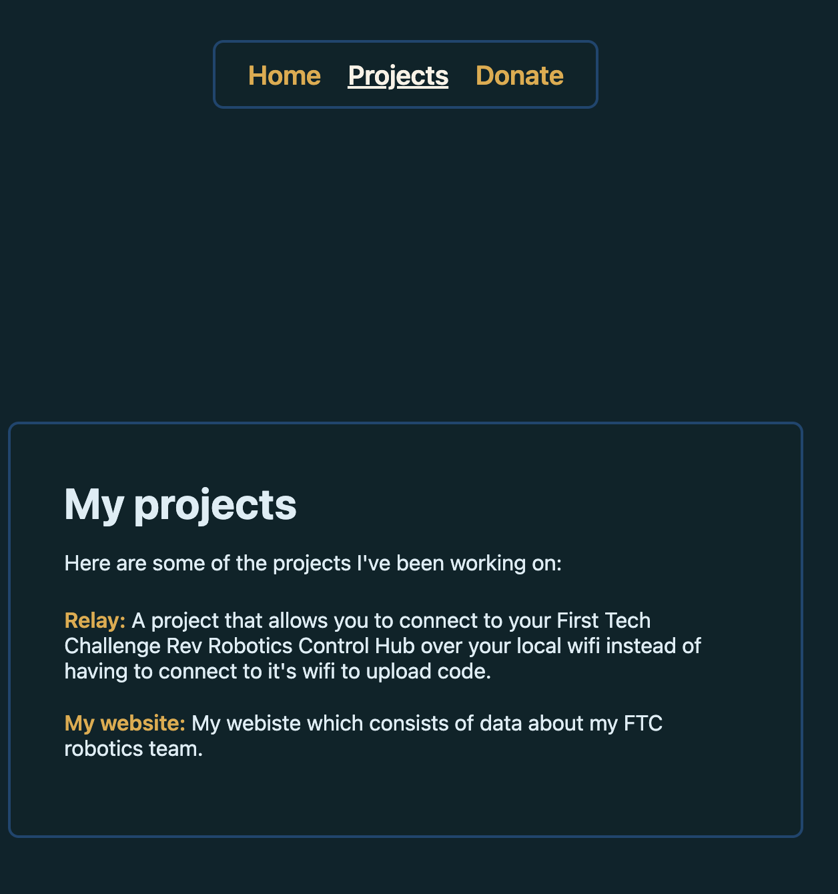
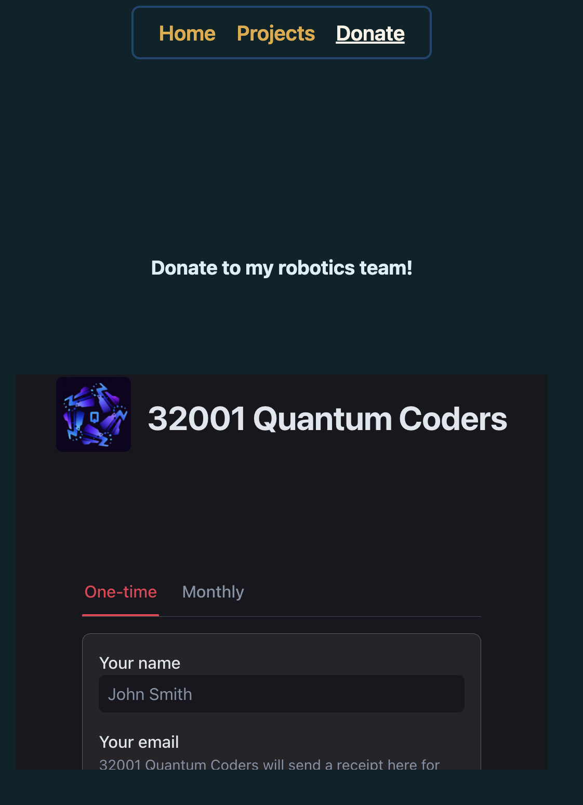

# Raise My Builder Project
!
This is my website where I showcase my own projects and provide a donate page for people who want to support what I'm building for the raise a builder trial. I made this website to have a place to show off my work, share my projects with others, and make it easy for people to find out more about what I'm doing. Basically, this is where I get to show off my creations and give people a way to support them!

## Screenshots

### Home

This is the home page of my website. It introduces Raise a Builder and gives visitors an idea of what I'm working on.

### Projects

This is where I showcase my own projects and let visitors check out what I've been building.

### Donate

This page is for people who want to support me and the projects I'm working on. It provides a cool place for visitors to find OUR donation information four our ftc team.

## Viewing the Project

Want to check out my website? There are two ways to do it!

**Option 1: Open the Demo**

Just open the demo link in the right sidebar of the repository (if available) and check out my website.

**Option 2: Run It Locally**

1. Clone this repository to your computer.
2. Open the folder you downloaded.
3. Double-click `index.html`.
4. That's it! My website should open in your default web browser.

No complicated setup or installing a million different things required. Just open it and take a look!

## Tech Stack

Here's what I used to build my website:

- **HTML5:** Used to structure my website and organize the content across my home, projects, and donate pages.
- **CSS3:** Used to style my website, including the layout, colors, fonts, spacing, and overall appearance.
- **Web Browser:** Used to run and display my website. Since I use standard web technologies, I can open it directly in a browser without needing a complicated build process.

I kept things simple by using standard web technologies, making my website easy to open, view, and work on.

## Overview and How to Use

Raise a Builder is my personal website for showcasing the projects I've created and giving people a place to learn about my work and support what I'm building.

Visitors can start on the home page to get an introduction to my website, head over to the projects page to explore my work, and visit the donate page if they want to support my ftc team (lowk need the money). 

The website is also easy to run locally. Just clone the repository, open `index.html` in a browser, and you're good to go!

## Contributing

It's my website and my projects, so idk why you'd wanna commit to it but if you have ideas for improvements, find a bug, or want to suggest something, feel free to do so!

If you decide to contribute, please make sure your changes are useful and include a descriptive commit message explaining what you changed. Something like `Improve projects page layout` is a lot better than `fixed stuff lol`.

## License

This project is licensed under the MIT License. Check out the [LICENSE.md](LICENSE.md) file for the full license text.