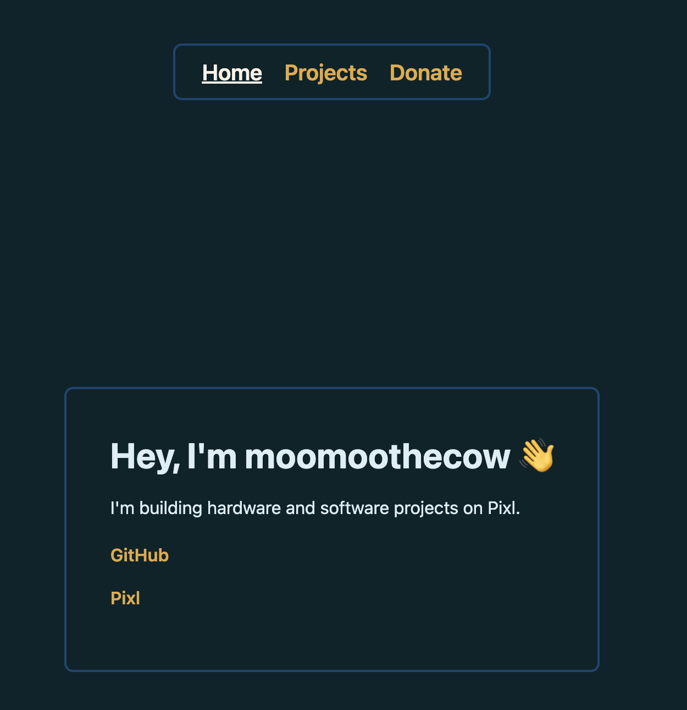

# Raise a Builder Page

My portfolio site for [Pixl](https://pixl.hackclub.com), made for Hack Club's Raise a Builder. Three pages — home, projects, and donate — in a dark teal theme, built with plain HTML and CSS. No framework, no build step, no dependencies; you can open `index.html` and it just works. Home is a short intro with links to my GitHub and Pixl, projects lists what I've been working on (mostly [Relay](https://github.com/Bob-41/Relay), which uploads code to an FTC Rev Robotics Control Hub over your local wifi instead of the robot's own network), and donate embeds a Hack Club Bank form for my FTC team, Quantum Coders.

To run it, clone the repo and serve the folder with `python3 -m http.server 8000`, then open <http://localhost:8000>. Serving it instead of opening the file directly just keeps the links between pages behaving the same as they do once deployed. There's nothing to install and nothing to rebuild — edit `style.css`, reload, and all three pages update at once.

Everything's in three HTML files (`index.html`, `about.html`, `donate.html`) sharing one stylesheet, with nav as plain `<a>` tags between them. The colors live at the top of `style.css` if you want to change them, and the whole folder can go straight onto GitHub Pages, Netlify, or Cloudflare Pages with no build command.

